# Diagrama de Casos de Uso UML — Jinhwa Corporation
> **Casos de Uso del Sistema de Gestión Marcial de Taekwondo**  
> Formato nativo Mermaid para **Obsidian**, GitHub y documentación técnica.

---

## 1. Diagrama de Casos de Uso (Mermaid)

```mermaid
flowchart LR

    %% =============================================================
    %% ACTORES (Representados con íconos / estilizados)
    %% =============================================================
    subgraph ACTORES_PUBLICOS [" Actores Externos "]
        A_VISITANTE(["👤 Visitante Web"]):::actorPublic
        A_ESTUDIANTE(["🥋 Estudiante"]):::actorStudent
    end

    subgraph ACTORES_INTERNOS [" Actores Administrativos "]
        A_MAESTRO(["🥋 Maestro / Instructor"]):::actorMaster
        A_ADMIN(["👑 Administrador Central"]):::actorAdmin
    end

    %% =============================================================
    %% SISTEMA: MÓDULOS Y CASOS DE USO (Límite del Sistema)
    %% =============================================================
    subgraph SISTEMA [" SISTEMA DE GESTIÓN JINHWAN CORPORATION "]

        subgraph MOD_PUBLICO [" Módulo 1: Portal Web Público "]
            UC01(["UC01: Consultar Portal e Inicio"]):::ucPublic
            UC02(["UC02: Consultar Sedes y Horarios"]):::ucPublic
            UC03(["UC03: Consultar Galería Multimedia"]):::ucPublic
            UC04(["UC04: Consultar Instructores"]):::ucPublic
            UC05(["UC05: Solicitar Pre-Registro Web"]):::ucPublic
            UC06(["UC06: Iniciar Sesión / Login"]):::ucPublic
        end

        subgraph MOD_ESTUDIANTE [" Módulo 2: Portal Estudiante "]
            UC07(["UC07: Ver Dashboard del Estudiante"]):::ucStudent
            UC08(["UC08: Consultar Material Teórico por Grado"]):::ucStudent
            UC09(["UC09: Marcar Teorías Favoritas"]):::ucStudent
            UC10(["UC10: Historial de Diplomas y Ascensos"]):::ucStudent
            UC11(["UC11: Actualizar Perfil y Contacto"]):::ucStudent
        end

        subgraph MOD_MAESTRO [" Módulo 3: Portal Docente / Dojang "]
            UC12(["UC12: Visualizar Alumnos por Sede y Grupo"]):::ucMaster
            UC13(["UC13: Planificar Cronogramas de Clase"]):::ucMaster
            UC14(["UC14: Gestionar Banco de Ejercicios Físicos"]):::ucMaster
            UC15(["UC15: Asignar Ejercicios a Clases"]):::ucMaster
            UC16(["UC16: Evaluar Alumnos y Emitir Certificados"]):::ucMaster
            UC17(["UC17: Publicar en Galería y Eventos"]):::ucMaster
        end

        subgraph MOD_ADMIN [" Módulo 4: Dirección y Administración "]
            UC18(["UC18: Gestionar Sedes (CRUD)"]):::ucAdmin
            UC19(["UC19: Gestionar Grupos y Horarios (CRUD)"]):::ucAdmin
            UC20(["UC20: Gestionar Maestros e Instructores"]):::ucAdmin
            UC21(["UC21: Gestionar Estudiantes y Expedientes"]):::ucAdmin
            UC22(["UC22: Aprobar Pre-Registros Web"]):::ucAdmin
            UC23(["UC23: Ascensos Masivos y Generación Diplomas"]):::ucAdmin
            UC24(["UC24: Generar Reportes y Estadísticas"]):::ucAdmin
        end

    end

    %% =============================================================
    %% CONEXIONES DE ASOCIACIÓN (Actor -> Casos de Uso)
    %% =============================================================

    %% Visitante
    A_VISITANTE --- UC01
    A_VISITANTE --- UC02
    A_VISITANTE --- UC03
    A_VISITANTE --- UC04
    A_VISITANTE --- UC05
    A_VISITANTE --- UC06

    %% Estudiante
    A_ESTUDIANTE --- UC07
    A_ESTUDIANTE --- UC08
    A_ESTUDIANTE --- UC09
    A_ESTUDIANTE --- UC10
    A_ESTUDIANTE --- UC11

    %% Maestro
    A_MAESTRO --- UC12
    A_MAESTRO --- UC13
    A_MAESTRO --- UC14
    A_MAESTRO --- UC15
    A_MAESTRO --- UC16
    A_MAESTRO --- UC17

    %% Administrador
    A_ADMIN --- UC18
    A_ADMIN --- UC19
    A_ADMIN --- UC20
    A_ADMIN --- UC21
    A_ADMIN --- UC22
    A_ADMIN --- UC23
    A_ADMIN --- UC24

    %% Herencia entre roles
    A_ADMIN -.->|extends| A_MAESTRO

    %% =============================================================
    %% ESTILOS VISUALES
    %% =============================================================
    classDef actorPublic fill:#0369a1,stroke:#38bdf8,stroke-width:2px,color:#ffffff
    classDef actorStudent fill:#3730a3,stroke:#818cf8,stroke-width:2px,color:#ffffff
    classDef actorMaster fill:#065f46,stroke:#34d399,stroke-width:2px,color:#ffffff
    classDef actorAdmin fill:#581c87,stroke:#c084fc,stroke-width:2px,color:#ffffff

    classDef ucPublic fill:#0c4a6e,stroke:#38bdf8,stroke-width:1.5px,color:#f0f9ff
    classDef ucStudent fill:#1e1b4b,stroke:#818cf8,stroke-width:1.5px,color:#e0e7ff
    classDef ucMaster fill:#064e3b,stroke:#10b981,stroke-width:1.5px,color:#ecfdf5
    classDef ucAdmin fill:#3b0764,stroke:#c084fc,stroke-width:1.5px,color:#faf5ff
```

---

## 2. Matriz de Casos de Uso por Actor

| Actor | Módulo | Casos de Uso Asociados |
| :--- | :--- | :--- |
| **Visitante Web** | Portal Web | UC01, UC02, UC03, UC04, UC05, UC06 |
| **Estudiante** | Portal Alumno | UC07, UC08, UC09, UC10, UC11 |
| **Maestro** | Gestión Dojang | UC12, UC13, UC14, UC15, UC16, UC17 |
| **Administrador** | Dirección General | UC18, UC19, UC20, UC21, UC22, UC23, UC24 + capacidades de Maestro |
