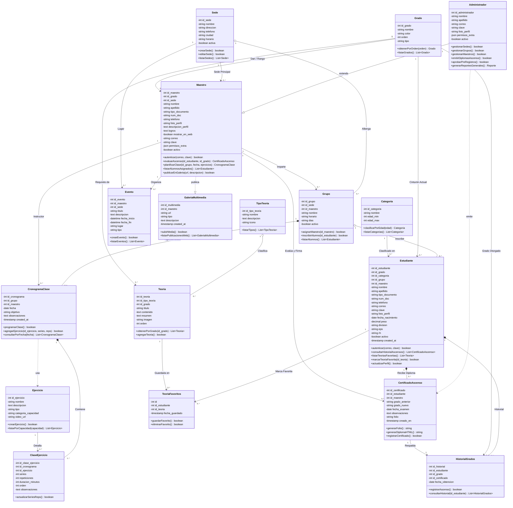

# Diagrama de Clases UML — Jinhwa Corporation
> **Arquitectura de Software y Modelo de Dominio de Base de Datos**  
> Formato nativo Mermaid para **Obsidian**, GitHub y herramientas Markdown estándar.

---

## 1. Diagrama de Clases UML (Mermaid)

---

## 2. Leyenda de Relaciones UML

| Notación | Símbolo UML | Tipo de Relación | Descripción en Jinhwa Corporation |
| :---: | :---: | :--- | :--- |
| `--\|>` | $\triangle$ | **Herencia** | `Administrador` hereda capacidades operativas de `Maestro`. |
| `..\|>` | $\dashrightarrow \triangle$ | **Realización** | `Maestro` implementa publicaciones en `GaleriaMultimedia`. |
| `..>` | $\dashrightarrow$ | **Dependencia** | `CronogramaClase` usa `Ejercicio`; `Administrador` emite certificados. |
| `o--` | $\diamondsuit$ | **Agregación** | `Sede` alberga `Grupo`; `Grupo` inscribe `Estudiante`. |
| `*--` | $\blacklozenge$ | **Composición** | `Estudiante` posee `Certificados` e `Historial`. `Grupo` posee clases. |
| `-->` | $\rightarrow$ | **Asociación** | Vínculos estructurales directos (maestro imparte grupo, etc.). |
