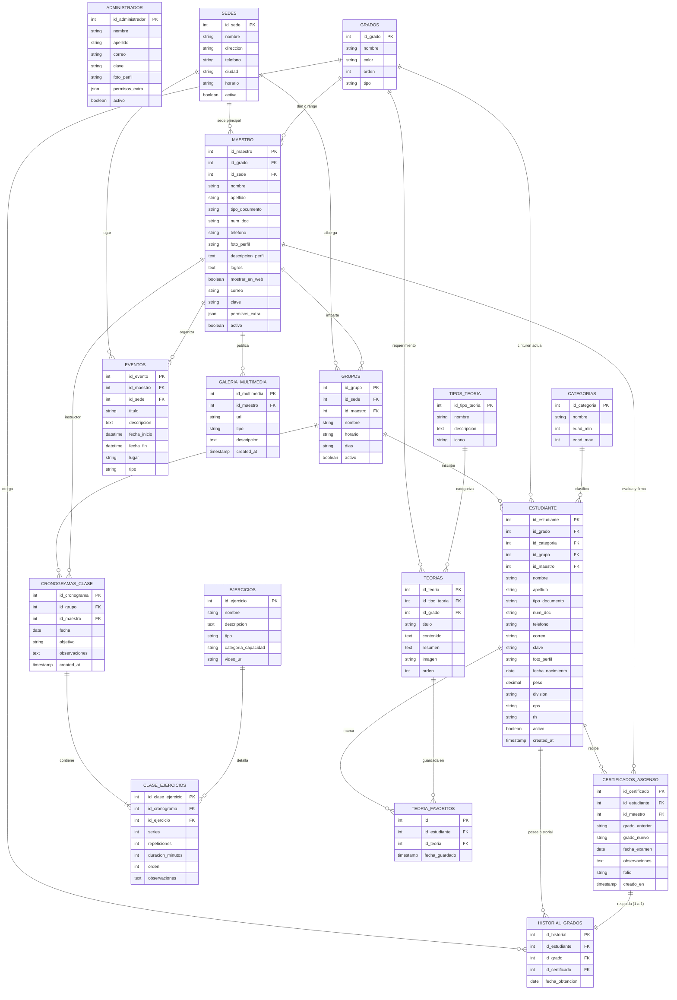

# Modelo Entidad-Relación (ER) — Jinhwa Corporation
> **Esquema de Base de Datos Relacional MariaDB / MySQL**  
> Formato nativo Mermaid para **Obsidian**, GitHub y documentación técnica.

---

## 1. Diagrama Entidad-Relación Completo (Mermaid)

---

## 2. Cardinalidades Representadas

| Símbolo | Significado | Ejemplo |
| :---: | :--- | :--- |
| `\|\|--o{` | **Uno a Muchos (1:N opcional)** | Una `SEDE` alberga de 0 a muchos `GRUPOS`. |
| `\|\|--\|{` | **Uno a Muchos (1:N obligatorio)** | Un `CRONOGRAMA` contiene al menos 1 `CLASE_EJERCICIO`. |
| `\|\|--\|\|` | **Uno a Uno (1:1 obligatorio)** | Cada `CERTIFICADO_ASCENSO` respalda exactamente 1 `HISTORIAL_GRADOS`. |
